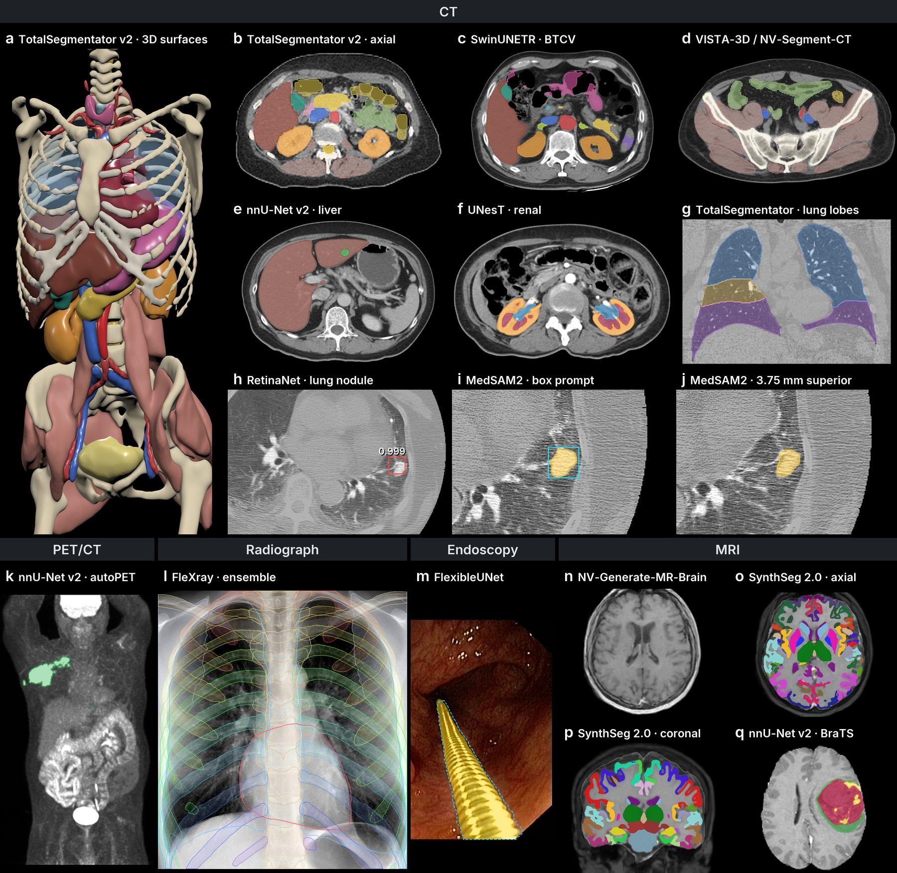

<div align="center">

# MedMLX

One Python API, command line and MCP server for native medical imaging on Apple Silicon.
Run TotalSegmentator, nnU-Net, MedSAM2, SynthSeg and more through their independent MLX runtimes.

[](https://pypi.org/project/medmlx/)
[](https://pypi.org/project/medmlx/)
[](https://github.com/MedMLX/medmlx/blob/main/LICENSE)
[](https://github.com/ml-explore/mlx)
[](https://huggingface.co/MedMLX)
[](https://github.com/MedMLX/medmlx/blob/main/docs/mcp.md)

[Models](#models) · [Setup guide](https://github.com/MedMLX/medmlx/blob/main/docs/setup.md) · [MCP guide](https://github.com/MedMLX/medmlx/blob/main/docs/mcp.md) · [Website](https://medmlx.org)



**Apple Silicon · Metal · Python 3.13** · [uv](https://docs.astral.sh/uv/)

</div>

## Install

```sh
uv tool install --python 3.13 "medmlx[all,mcp]"
```

For a Python project, use `uv add "medmlx[all,mcp]"`. Run `uv tool upgrade medmlx` to
update MedMLX and its models. Model weights download on first use and keep their own
terms. For a smaller install, replace `all` with one group:

| Extra | Installs |
| :--- | :--- |
| `all` | Every model runtime, with Reason-CT tools |
| `segment` | Segmentation runtimes, including SAM 3 video |
| `generate` | Reason-CT, NV-Generate, LesionDiffusion and FDG PET synthesis |
| `vision` | Lung nodule detection, RadImageNet features and radiomics |
| `mcp` | The MCP server |

## Quickstart

`medmlx models` lists the installed models. To segment a CT scan, put it in a
working folder:

```sh
mkdir -p ~/medmlx-work && cd ~/medmlx-work
cp /path/to/ct.nii.gz .
```

Save the run's arguments there as `arguments.json`. Relative paths resolve
against `--root`:

```json
{"image_path": "ct.nii.gz", "output_dir": "segment-ct"}
```

Then show the model's arguments, check that it can run, and run it:

```sh
medmlx describe mlx-segment-ct
medmlx readiness mlx-segment-ct --arguments arguments.json --root ~/medmlx-work
medmlx run mlx-segment-ct --arguments arguments.json --root ~/medmlx-work
```

- `readiness` checks Metal and the input paths without downloading anything.
- The first run downloads the `MedMLX/vista3d-ct-mlx` weights; later runs reuse the
  cache.
- The mask is written to `segment-ct/mlx_segment_ct_mask.nii.gz`.
- `medmlx setup --all --progress` downloads every model's weights for offline use. See
  [automatic weights and readiness](https://github.com/MedMLX/medmlx/blob/main/docs/setup.md).

## Models

Model IDs are what `medmlx run` and `medmlx describe` take.

| Model ID | Task | Input | Extra |
| :--- | :--- | :--- | :--- |
| `totalsegmentator` | Whole-body CT segmentation | CT | segment |
| `mlx-segment-ct`, `mlx-segment-ctmr` | Automatic and point-prompted segmentation (VISTA-3D) | CT, MRI | segment |
| `nnunet-liver`, `nnunet-pancreas`, `nnunet-autopet`, `nnunet-brats2021` | Organ and tumor segmentation (nnU-Net v2) | CT, PET/CT, brain MRI | segment |
| `mrsegmentator` | Multi-organ MRI segmentation | MRI | segment |
| `siam` | Whole-head segmentation from any MRI contrast or CT | Head MRI, CT | segment |
| `synthseg` | Brain segmentation and parcellation | Brain MRI, CT | segment |
| `medsam2` | Box-, point- or mask-prompted masks with propagation | NIfTI slices or volumes, frames | segment |
| `sam3` | Text-, box- or point-prompted image segmentation | 2D images, video frames | segment |
| `biomedparse-v2` | Text-prompted segmentation | 3D volumes, 2D images | segment |
| `swin-unetr` | 13 abdominal organs | Contrast CT | segment |
| `segresnet-brats`, `segresnet-renal-cect` | Brain tumor and renal structures | Brain MRI, multiphase CT | segment |
| `unest` | Kidney cortex, medulla and collecting system | CT | segment |
| `flexray` | Radiograph anatomy | Radiographs | segment |
| `flexible-unet` | Surgical tools | Endoscopy frames | segment |
| `lung-nodule` | Lung nodule detection | Chest CT | vision |
| `radimagenet-*` | Radiology image features | 2D images | vision |
| `mlx-reason-ct` | CT reports and question answering | CT | generate |
| `reason-ct-tools` | Reason-CT with nodule detection and MedSAM2 masks | Chest CT | reason-tools |
| `mlx-generate-ctmr-ct`, `-mr`, `-mr-brain` | Synthetic CT and MRI | Label maps or anatomy | generate |
| `lesiondiffusion` | Synthetic CT lesions | CT and organ mask | generate |
| `fdg-pet-ct` | Synthetic FDG PET (weight-free) | CT and labels | generate |
| `medgemma` | Image-to-text through a separate environment | 2D images | [bridge](https://github.com/MedMLX/medmlx/blob/main/docs/medvlm-bridge.md) |

Each model has its own repository in the [MedMLX organization](https://github.com/MedMLX).
`medgemma` and `mrsegmentator` require local weights.

### Memory

MedMLX runs one model at a time by default. It never refuses a run for memory:
readiness reports a model's peak next to the memory available, and the run starts
either way, so a Mac with too little memory may swap or fail. Declared peaks:

| Model | Peak MLX memory |
| :--- | ---: |
| `mlx-generate-ctmr-ct` | 30 GB |
| `mlx-generate-ctmr-mr-brain` | 26 GB |
| `siam` | 16 GB |
| `mlx-reason-ct` | 14.5 GB |
| `sam3` | 12 GB |
| `synthseg` | 11.6 GB |
| `mlx-segment-ctmr` | 11.0 GB |
| `lung-nodule` | 10.8 GB |
| `swin-unetr` | 7.5 GB |
| `unest` | 7.3 GB |
| `mlx-segment-ct` | 6.0 GB |
| `totalsegmentator`, `segresnet-brats` | 5.0 GB |
| `segresnet-renal-cect` | 4.1 GB |
| `biomedparse-v2` | 3.9 GB |
| `lesiondiffusion` | 3.5 GB |
| `fdg-pet-ct` | 2.8 GB |
| `medsam2` | 1.3 GB |
| `flexray` | 1.2 GB |
| `radimagenet-*`, `flexible-unet` | 0.5 GB or less |

Models without a declared peak, including `nnunet-liver`, `nnunet-pancreas`,
`nnunet-brats2021` and `nnunet-autopet`, record their measured peak after each
run, and `medmlx describe` reports it.

`medgemma` runs in its own interpreter, outside this check. Describing a chest
radiograph peaks at 4.4 GB with MedGemma 1.5 4B and 17.9 GB with MedGemma 27B.

## MCP

`medmlx serve --root /path/to/work` runs a stdio MCP server that lets an
assistant list models, check inputs and run jobs in that folder. For Claude Code:

```sh
mkdir -p ~/medmlx-work
claude mcp add --scope user medmlx -- "$(uv tool dir --bin)/medmlx" serve --root "$HOME/medmlx-work"
```

For clients configured with JSON, use absolute paths:

```json
{
  "mcpServers": {
    "medmlx": {
      "command": "/absolute/path/to/medmlx",
      "args": ["serve", "--root", "/absolute/path/to/medmlx-work"]
    }
  }
}
```

Disconnecting the client cancels its running jobs. The
[MCP guide](https://github.com/MedMLX/medmlx/blob/main/docs/mcp.md) covers Codex,
other clients, tools and a complete job workflow.

## Python

```python
import medmlx

result = medmlx.run(
    "mlx-segment-ct",
    arguments={"image_path": "ct.nii.gz", "output_dir": "segment-ct"},
    root="/path/to/medmlx-work",
)
```

## More

- [Reason-CT with nodule tools](https://github.com/MedMLX/medmlx/blob/main/docs/reason-ct-tools.md):
  detect and segment nodules, then browse masks and measurements in a local CT viewer.
- [MedGemma bridge](https://github.com/MedMLX/medmlx/blob/main/docs/medvlm-bridge.md):
  run MedGemma in a managed environment with local weights.
- This README describes the 0.4.7 release on [PyPI](https://pypi.org/project/medmlx/).
  Unreleased changes are in the [release notes](https://github.com/MedMLX/medmlx/blob/main/docs/release-notes.md);
  to use them, install from the locked source workspace described in the
  [MCP guide](https://github.com/MedMLX/medmlx/blob/main/docs/mcp.md).
- Development: [declaring models](https://github.com/MedMLX/medmlx/blob/main/docs/declaring-models.md),
  [checkpoint conversion](https://github.com/MedMLX/medmlx/blob/main/conversion/README.md)
  and the [shared core runtime](https://github.com/MedMLX/medmlx/blob/main/packages/core/docs/technical.md).

## License

[Apache-2.0](https://github.com/MedMLX/medmlx/blob/main/LICENSE). See [third-party notices](https://github.com/MedMLX/medmlx/blob/main/THIRD_PARTY_NOTICES.md).
Runtimes and model weights retain their own terms.
